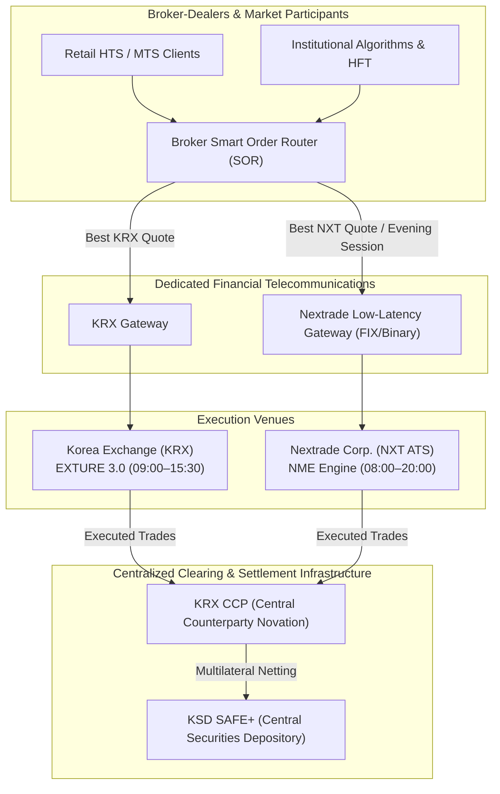
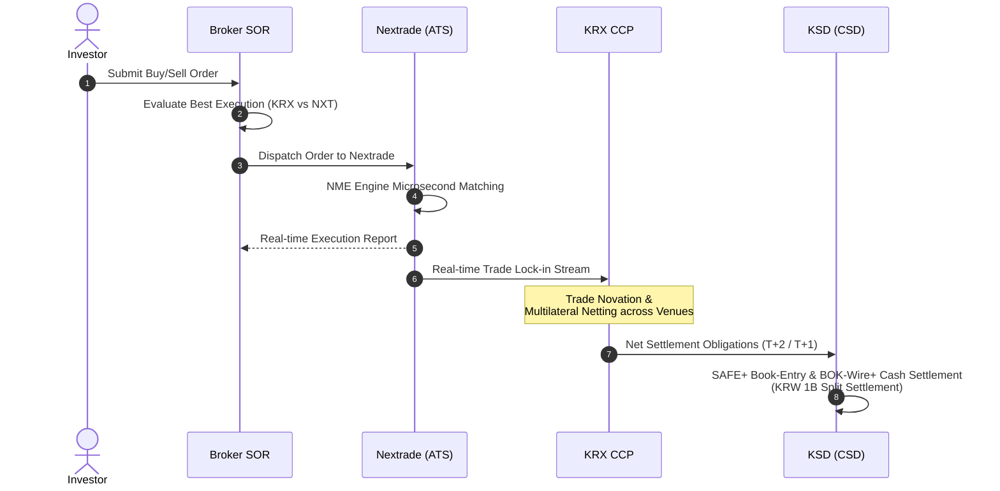

```{=html}
<div class="doc-header-card">
  <div class="doc-header-left">
    <span class="doc-badge category">📁 Equities &gt; ATS English Report</span>
    <span class="doc-badge tier">⭐ TIER 1 Market Infrastructure</span>
    <span class="doc-badge date">📅 2026-10-20</span>
  </div>
  <div class="doc-header-right">
    <a href="../../ko/exchanges/nextrade.html" class="doc-lang-btn">🇰🇷 Read in Korean</a>
  </div>
</div>
```

## 1. Overview & Profile

| Item | Details |
|------|---------|
| **Official Name** | Nextrade Corp. (넥스트레이드 주식회사) |
| **Brand / Acronym** | Nextrade / NXT |
| **Website** | [https://www.nextrade.co.kr](https://www.nextrade.co.kr) |
| **Established Date** | November 4, 2022 (Incorporation); March 4, 2025 (Official trading launch under FSC final authorization) |
| **Headquarters** | Yeouido, Seoul, Republic of Korea |
| **Legal Classification** | Multilateral Trading Facility / Alternative Trading System (ATS) under Financial Investment Services and Capital Markets Act (FSCMA) |
| **Ownership Structure** | Joint consortium formed by Korea Financial Investment Association (KOFIA), Korea Securities Depository (KSD), KOSCOM, and 21 major securities brokerages (Mirae Asset, Korea Investment, NH, KB, Samsung, etc.) |
| **Regulatory Authority** | Financial Services Commission (FSC) / Financial Supervisory Service (FSS) |
| **Trading Universe** | Top liquid ordinary shares listed on KOSPI and KOSDAQ (~800 benchmark stocks) |
| **Trading Hours** | 08:00 – 20:00 KST (12-hour continuous session framework) |
| **Market Share** | Stabilized at 10%–15% of eligible KOSPI/KOSDAQ trading volume as of October 2026 |
| **Core Trading Engine** | **Nextrade Matching Engine (NME)** — Ultra-low latency C/C++ in-memory architecture |
| **Post-Trade Infrastructure**| Clearing: **KRX CCP** (Central Counterparty Novation) / Settlement: **KSD SAFE+** (Central Securities Depository) |

### Key Milestones

- **August 2013:** Legal foundation for Alternative Trading Systems (ATS) introduced into the Financial Investment Services and Capital Markets Act (FSCMA).
- **November 2022:** Nextrade Corp. established by KOFIA and a consortium of 21 brokerage houses.
- **March 2023:** Preliminary ATS regulatory license granted by the Financial Services Commission (FSC).
- **Q4 2024:** Broker-dealer mock trading trials and Best Execution Smart Order Routing (SOR) algorithmic verification completed.
- **March 4, 2025:** Final regulatory authorization approved; official commercial launch of Korea's first alternative exchange, ending the 69-year monopoly of the Korea Exchange (KRX).
- **July 2025:** Rapid expansion of liquidity in KOSPI 200 / KOSDAQ 150 benchmark names; broker SOR order routing ratio crossed 25%.
- **December 2025:** Fee optimization and Midpoint order execution surge following KRX's transition to a maker-taker pricing schedule.
- **April 2026:** Integration with KSD's KRW 1 billion split-settlement mechanism and enhanced intra-day settlement monitoring.
- **October 2026 (Present):** Full maturation of the 12-hour dual-market competition regime, maintaining >12% average daily equity turnover share (as of October 20, 2026).

---

## 2. Market Structure & Sessions

Nextrade expands Korea's equity trading landscape beyond KRX's standard hours (09:00–15:30) to provide a **12-hour continuous trading day (08:00–20:00 KST / 23:00–11:00 UTC)**, allowing retail and institutional investors to react immediately to overnight US and European market events.

### 2.1 Trading Sessions Breakdown

| Session | Local Time (KST) | UTC | Trading Mechanism | Key Characteristics |
|---------|-----------------|-----|-------------------|---------------------|
| **Pre-Market** | 08:00 – 08:50 | 23:00 – 23:50 | Continuous Auction | Early price discovery absorbing overnight US macroeconomic events |
| **KRX Open Reference Buffer** | 08:50 – 09:00 | 23:50 – 00:00 | Order Queuing / Buffer | Pauses executions to align with KRX opening call auction price determination |
| **Regular Session** | 09:00 – 15:20 | 00:00 – 06:20 | Continuous Auction | Runs in parallel with KRX main session; broker SOR dynamically routes flow |
| **KRX Close Reference Buffer** | 15:20 – 15:30 | 06:20 – 06:30 | Order Queuing / Buffer | Prevents dislocation against KRX closing call auction |
| **After-Market** | 15:30 – 20:00 | 06:30 – 11:00 | Continuous Auction | 4.5-hour evening session covering commuter hours and European market openings |

### 2.2 Trading Universe & Statutory Volume Caps

- **Eligible Instruments:** Approximately 800 highly liquid KOSPI and KOSDAQ common stocks.
- **Excluded Instruments:** ETFs, ETNs, ELWs, structured warrants, and bonds are currently excluded under prevailing ATS statutory restrictions (phased expansion under regulatory review).
- **Statutory Volume Caps:**
  - Total market trading volume on ATS must remain within **15%** of aggregate market volume over the preceding 6 months (FSCMA Enforcement Decree).
  - Trading volume in any individual stock must remain within **30%** of total market volume.

### 2.3 Tick Size Policy (Sub-Penny / Finer Tick Increments)

Nextrade established narrower tick sizes compared to KRX's legacy schedule, significantly lowering effective bid-ask spreads for investors.

| Price Range | KRX Legacy Tick | Nextrade Tick (NXT) | Spread Reduction |
|-------------|-----------------|---------------------|------------------|
| **Below KRW 1,000** | KRW 1 | KRW 1 | Parity |
| **KRW 1,000 – <2,000** | KRW 1 | **KRW 1** | Parity |
| **KRW 2,000 – <5,000** | KRW 5 | **KRW 1** | **80% Spread Reduction** |
| **KRW 5,000 – <20,000** | KRW 10 | **KRW 5** | **50% Spread Reduction** |
| **KRW 20,000 – <50,000** | KRW 50 | **KRW 10 / 20** | **60–80% Spread Reduction** |
| **KRW 50,000 – <200,000**| KRW 100 | **KRW 50** | **50% Spread Reduction** |

---

## 3. Trading Mechanism

### 3.1 Order Matching & Priority

- **Execution Model:** 100% electronic continuous order-driven matching.
- **Priority Sequence:**
  1. **Price Priority:** Best bid (highest) and best offer (lowest) always execute first.
  2. **Time Priority:** Orders entered earlier at the same price execute first.
  3. **Strict Non-Internalization:** All incoming orders are exposed directly to the centralized central order book (CLOB).

### 3.2 Continuous Trading vs. Call Auctions

- Nextrade eliminates discrete batch call auctions at the open and close, prioritizing uninterrupted continuous liquidity.
- During KRX call auction windows (08:50–09:00 and 15:20–15:30), Nextrade syncs order book states to eliminate arbitrage dislocations.

---

## 4. Order Types

Nextrade pioneered advanced order types previously unavailable in the Korean domestic equity market, later prompting KRX to adopt matching features.

| Order Type | Korean Term | Mechanism & Features |
|------------|-------------|----------------------|
| **Limit Order** | 지정가호가 | Standard order with specified price and quantity |
| **Market Order** | 시장가호가 | Executes immediately against opposite top-of-book liquidity |
| **Midpoint Order** | 중간가호가 | Executes strictly at the midpoint of the consolidated National Best Bid and Offer (NBBO) |
| **Stop-Limit Order**| 스톱지정가호가 | Triggered when market touches the stop activation price, generating a limit order |
| **Conditional Limit**| 조건부지정가호가 | Operates as a limit order during continuous session; converts to market at close |
| **Best Limit** | 최유리지정가호가 | Pegs price automatically to the same-side best prevailing quote |
| **Top of Book** | 최우선지정가호가 | Pegs price automatically to the opposite-side best prevailing quote |
| **IOC** | Immediate-Or-Cancel | Executes all or part immediately; unexecuted balance is canceled |
| **FOK** | Fill-Or-Kill | Executes in its entirety immediately, otherwise fully canceled |

### 4.1 Midpoint Order Mechanics
* Midpoint orders execute at the mathematical midpoint $\frac{P_{bid} + P_{ask}}{2}$ of the prevailing best consolidated prices across KRX and Nextrade.
* Provides zero-spread execution and 50% price improvement for both buying and selling counterparties while eliminating adverse selection.

---

## 5. Trading Engine & IT Architecture

Nextrade utilizes an in-house developed ultra-low latency architecture: the **Nextrade Matching Engine (NME)**.

### 5.1 Architecture Overview

| Component | Technical Specifications | Engineering Characteristics |
|-----------|--------------------------|-----------------------------|
| **Engine Name** | **Nextrade Matching Engine (NME)** | 100% C/C++ in-memory deterministic matching core |
| **Order Turnaround Latency** | **10 – 15 μs (Median Round-trip)** | Ultra-low microsecond execution matching international Tier 1 standards |
| **Throughput Capacity** | **200,000+ TPS** | Non-blocking queue processing designed for heavy algorithmic flow |
| **Network Acceleration** | **Kernel-Bypass (Solarflare OpenOnload)** | Eliminates operating system network stack context-switch latency |
| **Platform Architecture** | Enterprise Linux x86-64 | NUMA node optimization, thread isolation, and CPU core pinning |
| **Disaster Recovery (DR)** | Real-time Active-Standby Sync | Sub-second stateful replication between Yeouido and Mokdong data centers |

### 5.2 Interface Protocols

- **Order Ingestion Gateway:**
  - **FIX 4.4 / 5.0 SP2:** Industry-standard protocol for retail broker platforms.
  - **Nextrade Binary Order Protocol (NBOP):** Ultra-low latency binary framing for HFT participants and broker SOR routers.
- **Market Data Feed:**
  - **FAST (FIX Adapted for STreaming):** Compressed historical and depth updates.
  - **Raw Binary Multicast UDP:** Tick-by-tick order additions, modifications, and trade executions with hardware timestamps.

---

## 6. Connectivity & Market Infrastructure



- **Proximity & Colocation:** Hosted within primary financial telecommunication centers (Yeouido & Mokdong) with deterministic equal-length fiber cross-connect policies.
- **API Access:** Secure API connections compliant with the Financial Security Institute (FSI) security architecture.

---

## 7. Risk Controls & Market Safeguards

Nextrade is tightly integrated with nationwide circuit breaker and volatility containment mechanisms to prevent systemic dislocations.

| Safeguard Mechanism | Nextrade (NXT) Implementation | Linkage with KRX Primary Market |
|----------------------|-------------------------------|----------------------------------|
| **Daily Price Limits** | **±30%** pegged to KRX reference price | Enforces exact upper/lower boundary of KRX |
| **Static VI** | 2-minute cooling pause upon abnormal price divergence from reference price | Real-time synchronization with KRX VI trigger broadcasts |
| **Dynamic VI** | Cooling pause triggered by multi-tick price slippage | Parity with KRX dynamic VI parameters |
| **Circuit Breakers (CB)**| Level 1, 2, and 3 market-wide trading halts | **Mandatory immediate halt upon KRX CB trigger** |

- **Pre-trade Risk Controls:** Hard limits on order notional value, fat-finger size limits, price collar validations, and sub-millisecond disconnect kill switches.

---

## 8. Best Execution (SOR) & Regulatory Framework

### 8.1 Best Execution Duty & Smart Order Routing (SOR)

Under Article 68 of the FSCMA and FSS regulatory guidelines, Korean securities brokerages are legally required to achieve Best Execution for client orders across fragmented venues.

* **SOR Routing Criteria:**
  1. **Price:** Routing to the venue displaying the superior bid or offer.
  2. **Total Costs:** Incorporating maker rebates and taker fee differentials.
  3. **Likelihood of Execution & Depth:** Order book size and historical fill rates.
  4. **Speed:** Microsecond transmission latency.

### 8.2 Statutory Market Share Caps
- **FSCMA Enforcement Decree Art. 77-3:** Restricts total ATS market share to 15% of nationwide trading volume, and 30% of any single security's volume.

---

## 9. Fees & Economics

| Fee Category | KRX Benchmark | Nextrade (NXT) | Economic Benefit |
|--------------|---------------|----------------|------------------|
| **Base Trading Fee** | 0.0022763% (~0.023 bp) | **0.0018 – 0.0020%** | **~20%–40% fee discount** |
| **Maker Incentive** | 0.00134% (Post Dec-2025) | **0.00100 – 0.00120%** | Favorable passive liquidity rebates |
| **Taker Fee** | 0.00182% (Post Dec-2025) | **0.00160 – 0.00170%** | Competitive liquidity extraction rate |
| **Clearing & Settlement** | Standard KRX CCP / KSD fee | Standard KRX CCP / KSD fee | Centralized post-trade cost parity |

---

## 10. Clearing & Settlement Integration



1. **Central Clearing (KRX CCP Novation):** All executed trades on Nextrade are captured in real-time by the KRX CCP, which novates the contracts, eliminates bilateral counterparty credit risk, and nets obligations multilaterally alongside KRX floor trades.
2. **Central Settlement (KSD SAFE+):** Net delivery obligations are settled through KSD's SAFE+ depository system against cash transfers at the Bank of Korea (BOK-Wire+), benefiting from the KRW 1 billion split-settlement system enacted in April 2026.

---

## 11. Strategic Implications for KRX IT

1. **Catalyst for KRX Engine Acceleration:** Direct competition with Nextrade motivated KRX to upgrade EXTURE 3.0 to single-digit microsecond latencies (8.6 μs) with kernel-bypass and FPGA accelerations.
2. **Accelerated Order Type Modernization:** Prompted KRX to introduce Midpoint and Stop-Limit orders and implement maker-taker fee pricing.
3. **Paving the Way for 24-Hour Trading:** The operational success of Nextrade's 12-hour session (08:00–20:00) provides the domestic benchmark for KRX's broader extended trading roadmap.

---

## Sources & References

1. [Nextrade Official Website](https://www.nextrade.co.kr) — Operational Regulations and Market Guide (Accessed Oct 2026).
2. Financial Services Commission (FSC) Press Release, "Final Approval of Alternative Trading System (ATS) Authorization", 2025.
3. Financial Supervisory Service (FSS), "Guidelines on Best Execution Obligations for Securities Brokerages", 2024.
4. Financial Investment Services and Capital Markets Act (FSCMA) & Enforcement Decree — Articles 77-2 & 77-3.
5. KED Global, "Nextrade challenges KRX with lower fees and extended 12-hour trading", 2025.
6. Korea Securities Depository (KSD), "Post-Trade Clearing and Settlement Integration Framework for Alternative Trading Systems", 2024.
7. Seoul Economic Daily, "Nextrade 12-Hour Trading Session Stabilization and Broker SOR System Architecture", 2026.
