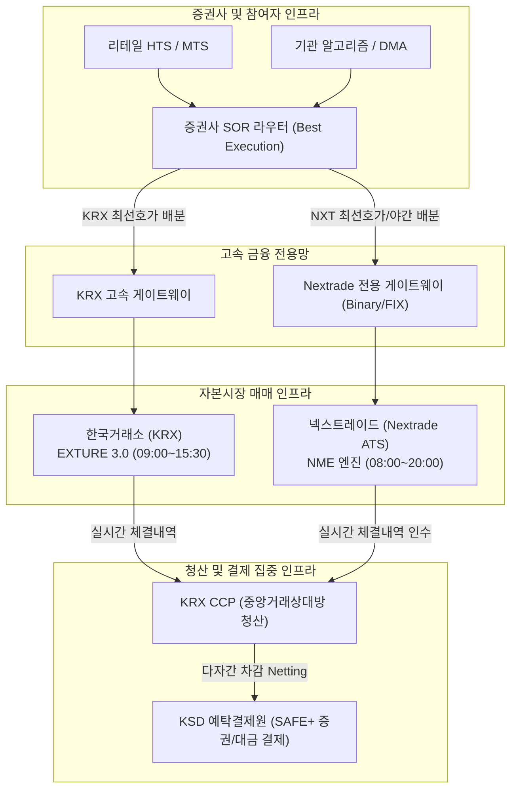
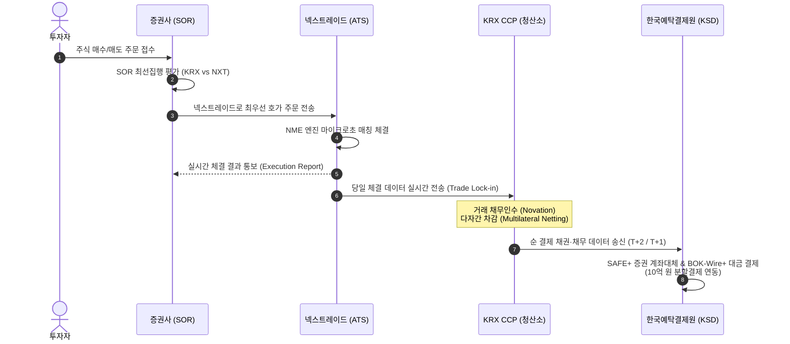

```{=html}
<div class="doc-header-card">
  <div class="doc-header-left">
    <span class="doc-badge category">📁 주식시장 &gt; 대체거래소(ATS) 한국어 리포트</span>
    <span class="doc-badge tier">⭐ TIER 1 자본시장 인프라</span>
    <span class="doc-badge date">📅 2026-10-20</span>
  </div>
  <div class="doc-header-right">
    <a href="../../en/exchanges/nextrade.html" class="doc-lang-btn">🌐 Read in English</a>
  </div>
</div>
```

## 1. 개요 및 프로필 (Overview & Profile)

| 항목 | 내용 |
|------|------|
| **공식 명칭** | 넥스트레이드 주식회사 (Nextrade Corp.) |
| **브랜드 / 약칭** | Nextrade / NXT (넥스트레이드) |
| **웹사이트** | [https://www.nextrade.co.kr](https://www.nextrade.co.kr) |
| **설립일** | 2022년 11월 4일 (법인 설립); 2025년 3월 4일 본인가 및 공식 영업 개시 |
| **본사 소재지** | 대한민국 서울특별시 여의도 |
| **법적 지위** | 자본시장법상 다자간매매체결회사 (대체거래소, ATS: Alternative Trading System) |
| **주주 구성** | 금융투자협회(KOFIA), 한국예탁결제원(KSD), 코스콤(KOSCOM) 및 21개 국내외 주요 증권사(미래에셋·한국투자·NH·KB·삼성증권 등) 컨소시엄 출자 |
| **규제 및 감독 기관** | 금융위원회 (FSC) / 금융감독원 (FSS) |
| **매매 대상 종목** | 유가증권시장(KOSPI) 및 코스닥(KOSDAQ) 주요 보통주 (~800여 개 우량 종목) |
| **거래시간** | 08:00 ~ 20:00 KST (12시간 연속거래 체계) |
| **시장 점유율** | 출범 초기 5~10% 수준에서 2026년 10월 현재 KOSPI/KOSDAQ 대상 종목 기준 10~15% 수준 안착 |
| **핵심 매매엔진** | **Nextrade Matching Engine (NME)** — 초저지연 C/C++ 인메모리 엔진 |
| **청산 및 결제** | 청산: **KRX CCP** (한국거래소 중앙청산 연계) / 결제: **KSD SAFE+** (한국예탁결제원) |

### 주요 연혁 (Milestones)

- **2013년 8월:** 자본시장과 금융투자업에 관한 법률 개정으로 다자간매매체결회사(ATS) 도입 법적 근거 마련
- **2022년 11월:** 금융투자협회 및 21개 증권사 출자로 넥스트레이드 주식회사 설립
- **2023년 3월:** 금융위원회로부터 다자간매매체결회사(ATS) 예비인가 취득
- **2024년 4분기:** 증권사 모의 매매 테스트 및 최선의 집행의무(SOR) 시스템 1차 연동 검증
- **2025년 3월 4일:** 금융위원회 본인가 승인 및 공식 주식 매매 서비스 개시 (KRX 69년 단일 거래소 독점 체제 종식)
- **2025년 7월:** KOSPI 200 및 코스닥 150 주요 유동성 종목 점유율 확대 및 증권사 SOR 주문 비중 25% 돌파
- **2025년 12월:** KRX의 메이커-테이커 수수료 개편에 대응하여 수수료 정책 최적화 및 중간가 호가 활성화
- **2026년 4월:** KSD-BOK 10억 원 단위 증권결제 분할체계 및 당일결제(T+0) 모니터링 연동 정착
- **2026년 10월 현재:** 12시간 거래(08:00~20:00) 안정적 운용, 복수 거래소 경쟁 환경 하에서 일평균 거래대금 비중 12% 이상 유지 (2026년 10월 20일 기준)

---

## 2. 시장 구조 및 매매세션 (Market Structure & Sessions)

넥스트레이드는 한국거래소(KRX)의 정규 매매시간(09:00~15:30)을 전후로 확장하여 **일일 총 12시간(08:00~20:00 KST)**의 연속 매매 환경을 제공합니다. 이를 통해 출퇴근 시간대 개인투자자의 거래 편의성을 극대화하고, 야간 해외 거시경제 이벤트에 즉각 대응할 수 있는 유동성 풀을 형성하고 있습니다.

### 2.1 매매세션 구성 (Trading Sessions)

| 세션 구분 | 한국 시간 (KST) | UTC | 매매 방식 | 주요 특징 |
|----------|----------------|-----|-----------|-----------|
| **프리마켓 (Pre-market)** | 08:00 ~ 08:50 | 23:00 ~ 23:50 | 접속매매 (연속경쟁) | 전일 미국 증시 및 글로벌 야간 이벤트 반영 시초 유동성 형성 |
| **동시호가 참조 대기** | 08:50 ~ 09:00 | 23:50 ~ 00:00 | 호가 접수 제한 / 대기 | KRX 시가 단일가매매(08:30~09:00) 결과 산출 연동 및 왜곡 방지 |
| **정규 매매 (Regular Session)** | 09:00 ~ 15:20 | 00:00 ~ 06:20 | 접속매매 (연속경쟁) | KRX 정규장과 동시 운영; 증권사 SOR 알고리즘에 의한 최적 분할 체결 |
| **종가 경매 참조 대기** | 15:20 ~ 15:30 | 06:20 ~ 06:30 | 호가 접수 제한 / 대기 | KRX 종가 단일가매매(15:20~15:30) 연동을 위한 호가 조정 |
| **애프터마켓 (After-market)** | 15:30 ~ 20:00 | 06:30 ~ 11:00 | 접속매매 (연속경쟁) | 정규장 마감 후 퇴근 시간대 및 유럽 시장 개장과 맞물린 4.5시간 야간 거래 |

### 2.2 거래 대상 종목 (Trading Universe)

- **대상 자산:** 유가증권시장(KOSPI) 및 코스닥(KOSDAQ) 보통주 중 시가총액과 거래대금이 풍부한 약 **800여 개 대표 우량 종목**.
- **제외 자산:** 자본시장법령상 ATS 취급이 제한되는 ETF(상장지수펀드), ETN(상장지수증권), 파생결합증권(ELW), 주식워런트, 채권 등 (추후 자본시장법 개정 논의에 따라 단계적 확대 검토 중).
- **종목별 거래량 한도 (Volume Caps):**
  - 자본시장법 시행령에 따라 ATS의 전체 시장 거래량은 직전 6개월 기준 전체 거래량의 **15%** 이내로 제한.
  - 개별 종목별 거래량은 해당 종목 전체 거래량의 **30%** 이내로 제한.

### 2.3 호가가격단위 (Tick Size) 세분화 정책

넥스트레이드는 KRX 대비 더 촘촘한 호가단위(Finer Tick Size)를 선제적으로 도입하여 투자자의 실질 스프레드 비용을 획기적으로 낮추었습니다.

| 가격 구간 | KRX 호가단위 (기존) | Nextrade 호가단위 (NXT) | 틱 축소 효과 |
|-----------|-------------------|------------------------|-------------|
| **1,000원 미만** | 1원 | 1원 | 동등 |
| **1,000원 ~ 2,000원 미만** | 1원 | **1원** | 동등 |
| **2,000원 ~ 5,000원 미만** | 5원 | **1원** | **스프레드 80% 축소** |
| **5,000원 ~ 20,000원 미만** | 10원 | **5원** | **스프레드 50% 축소** |
| **20,000원 ~ 50,000원 미만** | 50원 | **10원 / 20원** | **스프레드 60~80% 축소** |
| **50,000원 ~ 200,000원 미만**| 100원 | **50원** | **스프레드 50% 축소** |

> **💡 호가단위 축소 효과:** 호가단위가 촘촘해지면 최우선 매수·매도 호가 간의 괴리(Bid-Ask Spread)가 축소되어 대량 주문 및 리테일 거래에서 발생하는 암묵적 거래 비용(Implicit Cost)이 절감됩니다.

---

## 3. 매매 메커니즘 (Trading Mechanism)

### 3.1 주문 접수 및 체결 원칙

- **매매 방식:** 100% 전자식 접속매매 (Continuous Trading) 중심 구조.
- **체결 우선순위 원칙:**
  1. **가격 우선의 원칙 (Price Priority):** 높은 매수호가와 낮은 매도호가가 항상 우선 체결.
  2. **시간 우선의 원칙 (Time Priority):** 동일 가격 호가 간에는 먼저 접수된 호가가 우선 체결.
  3. **내부화 및 교차 체결 배제:** 공정 경쟁을 위해 모든 주문은 중앙 주문장(Central Order Book)에 집결되어 투명하게 매칭.

### 3.2 단일가매매 배제 및 연속성 유지

- 넥스트레이드는 개장 및 마감 시점에 별도의 단일가 매매(Call Auction)를 시행하지 않고 전 세션에 걸쳐 **연속 접속매매**를 지향합니다.
- KRX의 시가·종가 결정 시간대(08:50~09:00, 15:20~15:30)에는 시장 교란 방지를 위해 접수된 호가의 체결을 일시 대기하거나 KRX 산출 가격을 기준가로 동기화하는 구조를 갖추고 있습니다.

---

## 4. 호가 유형 (Order Types)

넥스트레이드는 국내 자본시장에 최초로 글로벌 선진 거래소 수준의 특화 호가(Advanced Order Types)를 도입하여 차별화된 유동성을 제공합니다.

| 호가 유형 | 영문 표기 | 기능 및 특징 | KRX 도입 여부 |
|----------|----------|-------------|--------------|
| **일반 지정가호가** | Limit Order | 가격과 수량을 지정하여 주문장에 등록 | KRX 기본 호가 |
| **시장가호가** | Market Order | 수량만 지정하여 최우선 상대호가와 즉시 체결 | KRX 기본 호가 |
| **중간가 호가** | **Midpoint Order** | 최우선 매수호가와 매도호가의 정중앙 가격(NBBO Midpoint)으로 자동 체결되는 비표시/개선 호가 | KRX 추후 도입 (2025.2) |
| **스톱지정가 호가** | **Stop-Limit Order** | 시장 가격이 투자자가 사전에 설정한 감시가격(Trigger Price)에 도달하면 지정가호가로 활성화 | KRX 추후 도입 (2025.2) |
| **조건부지정가호가** | Conditional Limit | 매매시간 중 지정가로 체결되지 않을 경우 마감 시점 시장가로 자동 전환 | KRX 기본 호가 |
| **최유리지정가호가** | Best Limit | 자기 방향 최우선 호가 가격으로 자동 정정 제출 | KRX 기본 호가 |
| **최우선지정가호가** | Top of Book Limit | 상대 방향 최우선 호가 가격으로 즉시 제출 | KRX 기본 호가 |
| **IOC (Immediate Or Cancel)** | Immediate-Or-Cancel | 즉시 체결 가능한 수량만 체결하고 잔여 수량은 자동 취소 | 공통 지원 |
| **FOK (Fill Or Kill)** | Fill-Or-Kill | 주문 전량이 즉시 체결되지 않으면 전량 자동 취소 | 공통 지원 |

### 4.1 중간가 호가 (Midpoint Order) 메커니즘
* 중간가 호가는 KRX와 Nextrade의 통합 최우선 매수호가(Best Bid)와 최우선 매도호가(Best Ask)의 산술 평균 가격으로 체결됩니다.
* 매수자와 매도자 모두에게 스프레드의 50%만큼 가격 개선(Price Improvement) 혜택을 제공하며, 시장 충격(Market Impact)을 최소화하고자 하는 기관 및 알고리즘 투자자에게 필수적인 도구입니다.

### 4.2 스톱지정가 호가 (Stop-Limit Order) 메커니즘
* 손실 제한(Stop Loss) 또는 이익 보존을 위한 리스크 관리 주문입니다.
* 특정 종목의 체결가격이 트리거 가격(Trigger Price)을 터치하는 순간, 사전에 지정된 지정가(Limit Price)로 즉시 주문장에 투입됩니다.

---

## 5. 매매체결 엔진 및 IT 인프라 (Trading Engine & IT Architecture)

넥스트레이드는 수십 년간 축적된 글로벌 ATS 기술을 벤치마킹하여 자체 개발한 **초저지연 고가용성 매매체결 엔진(Nextrade Matching Engine, NME)**을 탑재하고 있습니다.

### 5.1 아키텍처 개요

| 인프라 영역 | 상세 사양 | 기술적 특징 |
|------------|----------|-------------|
| **엔진 명칭** | **Nextrade Matching Engine (NME)** | 100% C/C++ 인메모리(In-Memory) 초저지연 매칭 아키텍처 |
| **체결 지연시간 (Latency)** | **10 ~ 15 μs (평균 Round-trip)** | 글로벌 선진 거래소 수준의 마이크로초 단위 응답성 보장 |
| **초당 처리량 (Throughput)** | 초당 **200,000+ 트랜잭션 (TPS)** | 대규모 알고리즘 및 HFT 유입 시에도 큐 지연 없는 논블로킹 매칭 |
| **네트워크 기술** | **Kernel-Bypass (Solarflare OpenOnload)** | OS 네트워크 스택 오버헤드를 배제한 직접 NIC 메모리 액세스 |
| **운영체제 및 플랫폼** | Enterprise Linux x86-64 | 고성능 CPU 코어 격리(Core Pinning) 및 NUMA 메모리 최적화 |
| **재해복구 (DR)** | 실시간 액티브-스탠바이 동기화 | 주센터(여의도/목동) 장애 시 무중단 페일오버 보장 |

### 5.2 인터페이스 프로토콜 (Connectivity Protocols)

- **주문 접수 (Order Gateway):**
  - **FIX 4.4 / 5.0 SP2:** 글로벌 표준 금융정보교환 프로토콜 지원.
  - **Nextrade Binary Order Protocol (NBOP):** 극초저지연 HFT 참여자 및 증권사 SOR 전용 바이너리 프로토콜.
- **시세 분배 (Market Data Distribution):**
  - **FAST (FIX Adapted for STreaming):** 고효율 압축 시세 피드.
  - **Raw Binary Multicast UDP:** 체결 및 호가 변동을 나노초 단위 타임스탬프와 함께 멀티캐스트 분배.
- **데이터 심도 (Market Depth):**
  - **Level 1 피드:** 최우선 매수·매도 호가(BBO), 최종 체결가 및 체결량.
  - **Level 2 피드:** 상위 10단계 호가 잔량 및 주문 잔량 합계.
  - **Full Depth (Tick-by-Tick):** 개별 주문 생성·정정·취소 이벤트 전수 실시간 스트리밍.

---

## 6. 접속 및 참여 (Connectivity & Access)

### 6.1 네트워크 연결 토폴로지

넥스트레이드는 여의도 및 목동 금융 데이터센터 내에 주 전산센터를 두고 국내 21개 증권사 및 글로벌 기관투자자와 직접 연결되어 있습니다.



### 6.2 코로케이션 (Co-location) 및 접근성
- **근접 호스팅 (Proximity Hosting):** 전산센터 내 서버 랙 임대 및 균등 배선(Equal-length Cabling) 정책 적용으로 지연시간 편차 배제.
- **클라우드 연계 가이드라인:** 금융보안원 보안 기준을 충족하는 클라우드 기반 핀테크 증권사의 오픈 API 접속 지원.

---

## 7. 위험 관리 및 시장안정화장치 (Risk Controls & Market Safeguards)

ATS는 단독으로 운영되는 고립된 시장이 아니므로, 시장 전체의 시스템 리스크를 방지하기 위해 KRX와 실시간으로 긴밀하게 연동되는 위험 관리 장치를 갖추고 있습니다.

### 7.1 시장안정화장치 연동 체계

| 안정화 장치 | 넥스트레이드 (NXT) 적용 방식 | KRX 연동 기준 |
|------------|---------------------------|---------------|
| **일일 가격제한폭** | **±30%** (KRX 전일 종가 또는 당일 기준가 기준) | KRX와 동일 상한가/하한가 적용 |
| **정적 변동성완화장치 (Static VI)** | 직전 단일가 또는 참조가 대비 일정 비율 이상 급변 시 2분간 매매 중단 또는 참조 단일가 전환 | KRX의 VI 발동 신호를 실시간 수신하여 NXT 오더북 동시 발동 |
| **동적 변동성완화장치 (Dynamic VI)** | 직전 체결가 대비 일정 틱 이상 급변 시 발동 | KRX와 동일한 트리거 비율 적용 |
| **서킷브레이커 (Circuit Breakers)** | 1/2/3단계 시장 거래 중단 | **KRX에서 CB가 발동되면 넥스트레이드도 의무적으로 즉시 거래 전면 중단** |

### 7.2 사전 거래 위험 제어 (Pre-trade Risk Controls)
- **주문당 최대 수량/금액 한도 통제:** 오타 주문(Fat-finger)에 의한 시장 교란 방지.
- **호가 스프레드 제한:** 비정상적으로 벌어진 가격의 주문 자동 거부.
- **킬스위치 (Kill Switch):**
  - **Disconnect Kill Switch:** 증권사 회선 두절 시 미체결 잔여 호가 자동 즉시 취소.
  - **Emergency Mass Cancellation:** 회원사 요청 시 계좌별 또는 회원사 전체 호가 일괄 취소.

---

## 8. 최선의 집행의무(SOR) 및 규제 체계 (Best Execution & Regulation)

### 8.1 최선의 집행의무 (Best Execution Mandate)

자본시장법 제68조 및 금융감독원의 「최선집행의무 가이드라인」에 따라 복수 거래소(KRX, Nextrade) 체제에서 증권사는 고객의 주문을 가장 유리한 조건으로 체결시킬 법적 의무를 부담합니다.

* **증권사 스마트 오더 라우팅 (Smart Order Routing, SOR):**
  - 각 증권사는 자체 알고리즘 또는 벤더 솔루션을 통해 KRX와 Nextrade의 실시간 호가를 밀리초 단위로 수집·비교.
  - **평가 요소:** 가격(Price), 거래 비용(Costs: 수수료 및 세금), 체결 가능성(Likelihood of Execution), 체결 속도(Speed).
  - 투자자의 명시적 지시가 없는 한, 가격과 수수료를 감안하여 총비용(Total Consideration)이 가장 우수한 시장으로 주문을 자동 분할 라우팅.

### 8.2 규제 한도 및 자율규제

- **자본시장법상 ATS 규제:**
  - 법적 지위: 투자매매·중개업 중 다자간매매체결업 인가.
  - 시장 지배력 제한: 자본시장법 시행령 제77조의3에 의거, 전체 시장의 15% 및 개별 종목의 30%를 초과할 수 없음.
- **불공정거래 감시 연계:**
  - 한국거래소 시장감시위원회(시감위) 및 금융감독원과 실시간 매매 데이터를 공유하여 시세조종, 미공개정보 이용, 무차입 공매도 행위를 통합 모니터링.

---

## 9. 수수료 및 비즈니스 모델 (Fees & Economics)

넥스트레이드는 단일 독점 거래소 대비 저렴한 수수료율과 유동성 공급 인센티브를 제공하여 시장 효율성을 증대시켰습니다.

| 수수료 항목 | KRX (한국거래소) | Nextrade (NXT) | 차이 및 절감 효과 |
|------------|-----------------|----------------|-------------------|
| **기본 거래 수수료** | 0.0022763% (약 0.023bp) | **약 0.0018 ~ 0.0020%** | **약 20~40% 수수료 인하** |
| **메이커 인센티브 (Maker)** | 0.00134% (2025.12 개편) | **0.00100 ~ 0.00120%** | 유동성 공급 주문에 우대 수수료 적용 |
| **테이커 요율 (Taker)** | 0.00182% (2025.12 개편) | **0.00160 ~ 0.00170%** | 유동성 소진 주문에 경쟁력 있는 요율 |
| **청산·결제 수수료** | KRX CCP / KSD 요율 부과 | 동일 연동 적용 | 포스트트레이드 비용은 표준 요율 |

---

## 10. 청산 및 결제 연동 (Clearing & Settlement Integration)

대한민국 자본시장은 매매 체결 영역에서는 복수 거래소 경쟁을 허용하되, 포스트트레이드(Post-trade) 영역에서는 위험 분산을 방지하고 규모의 경제를 달성하기 위해 **단일 집중 청산·결제 인프라**를 유지합니다.



1. **중앙청산 (KRX CCP Novation):**
   - 넥스트레이드에서 체결된 모든 거래는 실시간으로 한국거래소(KRX) 청산부서로 전송됩니다.
   - KRX CCP가 채무를 인수(Novation)하여 원거래자 간의 결제불이행 위험을 완벽히 차단하고, KRX 정규장 거래와 통합하여 다자간 순차감(Multilateral Netting)을 수행합니다.
2. **중앙예탁결제 (KSD SAFE+ Settlement):**
   - 차감된 최종 순 결제 내역은 한국예탁결제원(KSD)의 SAFE+ 시스템으로 전달되어 증권의 계좌대체와 한국은행 한은금융망(BOK-Wire+)을 통한 자금 결제가 동시에 완료(DvP Model 3)됩니다.
   - 2026년 4월 정착된 10억 원 단위 분할결제 체계를 동일하게 적용받아 야간 거래 확대에 따른 결제 유동성 병목을 완화하였습니다.

---

## 11. KRX IT 시사점 및 미래 전망 (Strategic Implications)

넥스트레이드의 성공적인 시장 안착은 한국거래소(KRX)의 IT 및 시장 운영 전략에 근본적인 패러다임 변화를 촉발했습니다.

1. **KRX 매매체결 엔진 고도화 가속:**
   - 넥스트레이드의 마이크로초 저지연 엔진에 대응하여 KRX는 **EXTURE 3.0**의 지연시간을 8.6μs까지 단축하고 패킷 지터(Jitter)를 극소화하는 하드웨어 가속(FPGA) 및 커널 바이패스 투자를 확대했습니다.
2. **호가 제도 및 서비스 혁신:**
   - 독점 체제에서는 소극적이었던 중간가(Midpoint) 및 스톱지정가(Stop-Limit) 호가를 KRX가 신속히 도입하게 된 직접적인 계기가 되었습니다.
   - 20년 만의 메이커-테이커(Maker-Taker) 수수료 개편 역시 ATS와의 유동성 유치 경쟁에서 기인했습니다.
3. **24시간 글로벌 거래 인프라 로드맵:**
   - 넥스트레이드가 08:00~20:00 12시간 거래를 정착시킴에 따라, KRX 또한 주식·ETF 애프터마켓(16:00~20:00)을 전면 도입하여 동등한 12시간 체제를 구축하였으며, 궁극적인 24시간 거래 체제로의 인프라 전환 로드맵을 가속화하고 있습니다.
4. **SOR 및 복수 시장 연계 표준화:**
   - 증권사 IT 시스템 전반에 걸쳐 초저지연 시세 취합 및 스마트 라우팅 역량이 필수 인프라로 자리 잡았으며, 향후 토큰증권(STO) 및 디지털 자산 다자간 매매 인프라와의 연계 모델로 확장되고 있습니다.

---

## 출처 및 참고 문헌 (Sources)

1. [넥스트레이드 공식 웹사이트](https://www.nextrade.co.kr) — 대체거래소 매매제도 및 운영 규정 안내 (2026년 10월 확인)
2. 금융위원회 (FSC) 보도자료, "다자간매매체결회사(ATS) 본인가 의결 및 자본시장 경쟁 촉진 방안", 2025.
3. 금융감독원 (FSS), "증권사 최선의 집행의무(Best Execution) 가이드라인", 2024.
4. 자본시장과 금융투자업에 관한 법률 (자본시장법) 및 동법 시행령 — 제77조의2, 제77조의3 (다자간매매체결회사의 인가 및 업무 규제).
5. KED Global, "Nextrade challenges KRX with lower fees and extended 12-hour trading", 2025.
6. 한국예탁결제원 (KSD), "대체거래소(ATS) 도입에 따른 청산결제 인프라 연계 방안", 2024.
7. 서울경제, "넥스트레이드 12시간 주식 매매 안착과 증권사 SOR 라우팅 시스템 현황", 2026.
